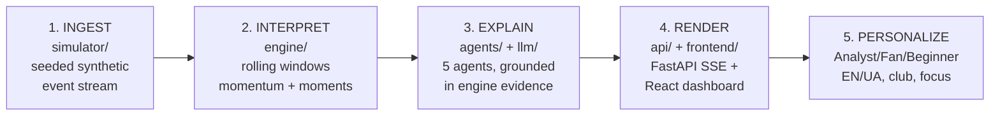
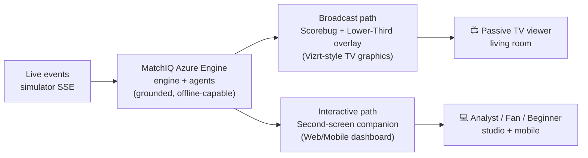

# MatchIQ

Real-time, explainable football match intelligence for studio / broadcast / streaming use.
Built for the "Inside the Game: Developer Hackathon" (Microsoft + Premier League).
**All clubs, players, stadiums and events are synthetic and invented** — no real teams,
players, badges, logos or league branding anywhere in code, data or UI.

## Architecture

Five pipeline stages, one module per stage:



| Stage | Code | What it guarantees |
|---|---|---|
| 1. Ingest | `backend/app/simulator/` | Same seed + scenario = same match, 1200–1800 events, scripted story arcs |
| 2. Interpret | `backend/app/engine/` | Rolling 1/5/10-min stats, momentum index, detected moments — pure math, zero LLM |
| 3. Explain | `backend/app/agents/` + `backend/app/llm/` | Typed handoffs, retries/fallbacks, grounding check rejects invented numbers |
| 4. Render | `backend/app/api/` + `frontend/` | FastAPI SSE live stream, broadcast dashboard (pitch, pressure, feed, trace) |
| 5. Personalize | `PersonalizeAgent` | Mode, language, favorite club, player focus — rule-based, never invents data |

State persists behind the `MatchStore` interface: in-memory by default,
Azure Cosmos DB when configured.

## Dual-Experience Delivery

MatchIQ serves both hackathon use-cases from the same live engine:

- **📺 TV Broadcast View** (passive living-room experience) — the tactical
  pitch expands to a full-screen match feed with only a broadcast scorebug
  (`[NGU] 2–1 [EVR]`, minute, LIVE). Goals, big chances and tactical shifts
  automatically raise a broadcast lower-third graphic (badge, headline,
  engine-computed metric pills) with Azure AI Speech commentary, fading out
  after 8 seconds. ESC or the header pill returns to the console.
- **💻 Interactive Console** (second-screen OTT companion, default) — the full
  broadcast dashboard: pitch, pressure timeline, AI narrative, metrics,
  player dossiers, Tactical Copilot and the agent trace panel.



## Elite punditry toolkit

- **Pitch Control & Heatmap layers** (pitch header toggle): territorial
  influence zones (blue/red, ball-weighted) with automatic `NvM OVERLOAD`
  badges, plus a cumulative emerald→gold→red ball-activity heatmap.
- **Pundit measuring tool** (`📏 Measure` on the pitch): click any two players
  for a caliper line with real-metre distance; defender gaps over 22 m under
  pressure raise `⚠️ DEFENSIVE LINE RUPTURE` — clicking the badge asks the
  Tactical Copilot for a grounded explanation.
- **Stadium crowd ambience**: fully procedural Web Audio crowd murmur that
  roars on goals/chances, ducks to 30% under commentary, and follows the
  `🎙️ Live Audio` toggle. No audio assets, no dependencies.
- **Azure AI Foundry**: production chat client (`backend/app/llm/azure.py`,
  stdlib only) with strict grounding prompt and MockLLM fallback; configure
  via `MATCHIQ_AZURE_FOUNDRY_ENDPOINT / _API_KEY / _DEPLOYMENT` (default
  `gpt-4o`), legacy `MATCHIQ_AZURE_*` vars still work.

## Requirements

- Python 3.11+, pip
- Node.js 20+, npm (frontend only)
- Docker (optional, for `docker compose up`)
- Azure CLI + subscription (optional, for cloud deployment)

## Quickstart — local dashboard (2 terminals)

```powershell
cd backend
pip install -e ".[dev]"
uvicorn app.main:app --port 8000
```

```powershell
cd frontend
npm install
npm run dev
```

Open http://localhost:5173 — the demo match (Northgate United 2–1 Eastvale Rovers:
23' lead, 57' equaliser, 89' winner) plays automatically with live AI narrative.

## Quickstart — full stack with Docker (1 command)

```powershell
docker compose up --build
```

Frontend on http://localhost:5173 (proxies `/api` to the backend),
backend API on http://localhost:8000. Copy `.env.example` to `.env` first
if you want to inject Azure credentials.

## Quickstart — Azure (scale-to-zero)

```powershell
az login
.\infra\azure\deploy.ps1   # or: ./infra/azure/deploy.sh
```

Provisions a resource group, Container Apps environment, two apps with
**min-replicas 0** (backend 0.5 CPU/1 Gi, frontend 0.25 CPU/0.5 Gi) and a
serverless Cosmos DB. Secrets stay in your shell / Container Apps secrets —
see `infra/azure/README.md` for Foundry, Cosmos DB and Managed Identity setup.

## CLI (offline, no server needed)

```powershell
cd backend
python -m app.simulator generate --seed 42 --scenario demo
python -m app.simulator replay --speed 60
python -m app.engine feed --file ../data/samples/sample_demo_seed42.json
python -m app.agents run --mode fan --lang en
python -m app.agents run --mode beginner --lang uk --club NGU --player-focus NGU_10
python -m app.agents run --llm azure  # needs MATCHIQ_AZURE_* env vars, else MockLLM
```

## Test and lint

```powershell
cd backend
pytest -q
ruff check .
ruff format --check .
```

```powershell
cd frontend
npm run build
npm test   # 38 frontend unit tests (vitest): api targets, hooks, components
```

## Match controls (frontend)

- Header: play/pause, speeds `1x 10x 60x`, restart, Analyst/Fan/Beginner,
  EN/UA, `🎙️ Live Audio` (Azure Speech → browser voice fallback + crowd),
  experience pill `📺 TV / 💻 Console` (remembered, ESC returns to console).
- Pitch header: layer toggle `Tokens / Pitch Control / Heatmap`,
  `📏 Measure` (click two players; `⚠️` rupture badge asks the Copilot),
  `Tactical Lines` team-shape boxes; every token opens the player dossier.
- TV mode: fullscreen pitch, scorebug, auto lower-thirds, `↺ Restart`.

## Microsoft & Azure Technologies

- **Azure Container Apps** — backend + frontend deploy as two serverless
  containers with scale-to-zero (`minReplicas: 0`), keeping idle cost at ~0.
  Scripts: `infra/azure/deploy.sh` / `deploy.ps1`.
- **Microsoft Foundry** — production chat models plug into the existing
  `AzureFoundryLLM` client via environment variables; every generated line
  still passes the evidence grounding check. See `infra/azure/README.md`.
- **Azure Cosmos DB** — serverless SQL API store (`backend/app/store/cosmos.py`,
  stdlib REST, no new dependencies) implementing the `MatchStore` interface;
  automatic fallback to the in-memory store with no credentials.
- **Agentic design** — five single-responsibility agents (Event, Context,
  Explain, Story, Personalize) with explicit typed handoffs (`AgentMessage`,
  `Handoff`), per-agent retries, graceful degradation, and a fully inspectable
  trace log streamed live to the dashboard's Agent Trace panel.

## License

MIT — see [LICENSE](LICENSE).
